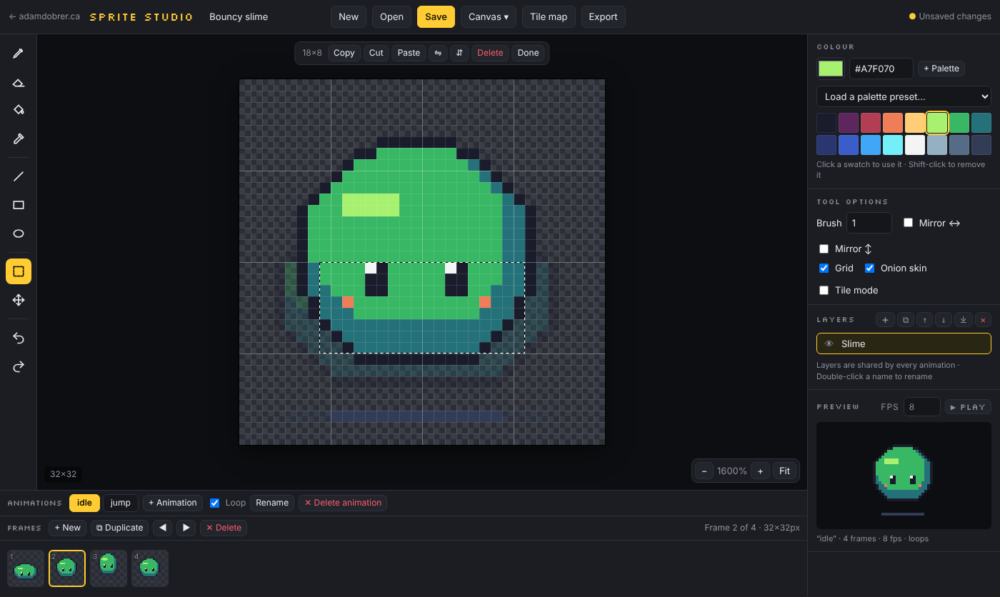
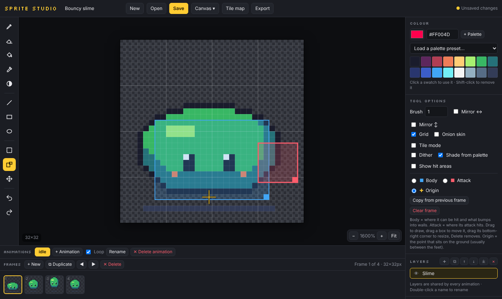

# Sprite Studio

A free pixel-art editor for drawing and animating sprites for video games. It runs in your browser: no install, no account, nothing uploaded.

**Use it:** [adamdobrer.ca/projects/sprite-studio/app/](https://adamdobrer.ca/projects/sprite-studio/app/)

## What it does

**Draw**
- Pencil, eraser, fill, colour picker, line, rectangle and ellipse, with brush sizes 1–8
- Mirror drawing for symmetrical characters
- Shade brush: click to darken, right-click to lighten. It can step through your palette like a colour ramp
- Dither pattern for any painting tool or fill
- Select part of a sprite to move, flip, rotate, copy or paste it, even into another frame
- Retro palettes (PICO-8, Sweetie 16, Game Boy and more), or your own
- Canvas from 8×8 up to 256×256

**Animate**
- As many named animations per sprite as you need (idle, walk, jump, hurt…), each with its own frames, speed and loop setting
- Layers shared across every animation
- Onion skin and a live preview
- Colour swap: recolour every frame at once, or save the result as a new variant (handy for enemy versions)

**Build levels**
- Tile mode shows the sprite repeated around itself so you can see the seams; the Move tool wraps around the edges
- A test tile map: paint a level with your tiles and save it as a PNG

**Hit areas**
- Draw body boxes (where it can be hit, what bumps into walls) and attack boxes (where its attack lands) on each frame
- Set an origin point: the spot that sits on the ground, usually between the feet

## Getting sprites into a game

**Godot 4.** Export → Godot 4 gives you a zip. Unzip it into your project and drag the `.tscn` into a level. You get an `AnimatedSprite2D` that:
- has every animation, speed and loop setting in place
- draws with crisp pixels and sits on its origin point
- has `Body` and `Attack` areas (`Area2D`) whose shapes follow the hit areas frame by frame, and mirror when you set `flip_h`

Connect the areas' `area_entered` signals to react to hits, or call `get_boxes("attack")` from a script. Tested with Godot 4.3.

**Other engines (Unity, Phaser, GameMaker…).** Export a sprite sheet (one row per animation, or a grid) plus a JSON file listing each animation's frames, speed, loop setting, hit areas and origin.

Also: PNG of a single frame (1×–16× with crisp pixels), animated GIF, and a project file you can open again later.

## Saving

Save keeps sprites in your browser. Download a project file to back one up or move it to another device. Projects open again with Open → Import project file.

## Shortcuts

| Key | Does |
|---|---|
| B / E / G / I | Pencil / eraser / fill / colour picker |
| H | Shade (right-click lightens) |
| L / R / O | Line / rectangle / ellipse (Shift: snap or filled) |
| S | Select. Ctrl+C / X / V to copy, cut, paste; arrows nudge |
| K | Hit areas |
| M | Move layer |
| D / T / X | Dither / tile mode / mirror |
| , and . | Previous / next frame |
| Ctrl+Z / Ctrl+Shift+Z | Undo / redo |

The full list is under Canvas → Shortcuts.

## Running it yourself

It's one HTML file with no build step. Open `index.html` in a browser, or serve the folder with any static host (GitHub Pages works).

## Licence

MIT, see [LICENSE](LICENSE). The Silkscreen font is by Jason Kottke under the SIL Open Font License ([silkscreen-OFL.txt](silkscreen-OFL.txt)). The PICO-8 palette is by Lexaloffle and Sweetie 16 by GrafxKid.
